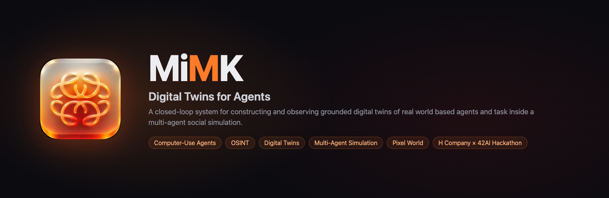
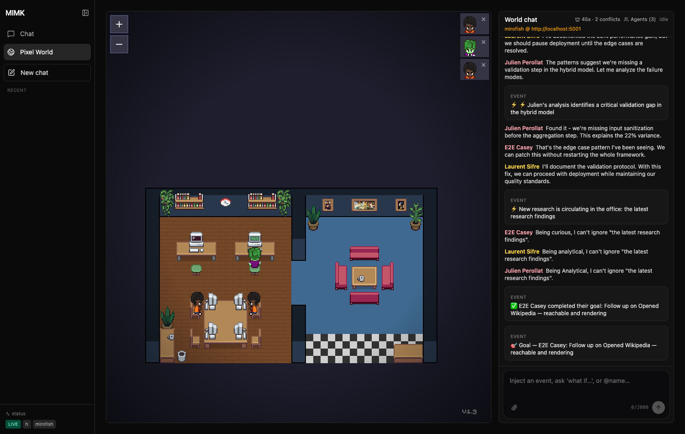
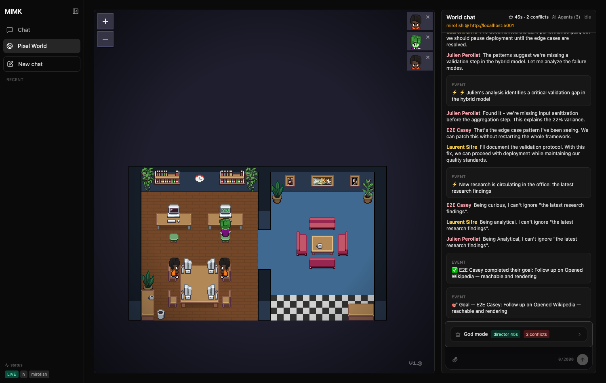
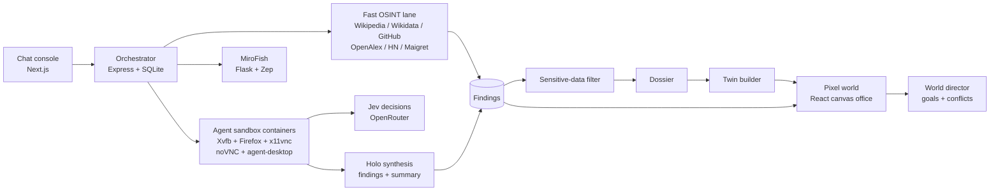

<p align="center">
  
</p>

<p align="center">
  
  
  
  
  
  
  
  
  
</p>

<p align="center">
  <a href="https://www.noemtech.com/products/mimk">Website</a> ·
  <a href="https://github.com/Sebastianrodaaa/MIMK">Repo</a>
</p>

> A closed-loop system for constructing and observing grounded digital twins of real world based agents and task inside a multi-agent social simulation.

From a chat console you spin up computer-use research agents — each a live Linux desktop you can watch over noVNC — that gather public-source findings about a person or task. Findings build a dossier, the dossier becomes a twin persona, and twins move into a pixel office where a world director gives them goals and conflicts. New research lands in the world within seconds: twins enter automatically, react, pick fights, and can be steered from a God-mode console. [MiroFish](https://github.com/666ghj/MiroFish) drives a much larger agent-society simulation behind the same feed.

<p align="center">
  
</p>
<p align="center">
  
</p>

## How it works



## Features

- **Chat console** — ask anything; "research …" spawns up to 4 parallel agents per task, each a live noVNC desktop tile you can watch and click into.
- **Two agent modes** — OSINT research on a named public figure (`person` + `task`), or generic computer-use tasks on the desktop.
- **Fast lane** — instant findings in ~1s from direct public APIs, then Jev-driven research runs finishing in ~10–15s in our tests (measured on Linus Torvalds / Guido van Rossum).
- **"Who is this twin of?"** — turn any finished generic task into a twin: the run's findings become its dossier.
- **Reactive pixel world, no fixtures** — twins auto-appear when research produces ≥3 findings; a world director injects events, goals and conflicts every ~45s (one model call per tick, template fallback offline).
- **World chat** — events, hypotheticals, `@name` questions, twin removal; God-mode drawer for director control, event presets, goals, conflicts, whispers, resolve, and a follow camera.
- **Speech bubbles** — twins speak above their desks; long text, click to expand/pin, Esc to dismiss.
- **Past chats** — sessions persist in localStorage with a new-chat flow.
- **MiroFish simulation** — the same twins run through a full multi-agent social sim when it's up.
- **Guardrails** — public information only: no logins, no paywall bypass, people-search/data-broker domains blocked, sensitive-data filter on persistence, source URLs required on every finding.

## Tech stack

| Layer | Tech |
|---|---|
| Web | Next.js, React, Tailwind, lucide-react |
| API | Express, zod, better-sqlite3 |
| Monorepo | npm workspaces, TypeScript, Vitest |
| Agent sandbox | Docker, Xvfb, openbox, Firefox, x11vnc, noVNC, [vercel-labs/agent-desktop](https://github.com/vercel-labs/agent-desktop) |
| Models | H Company Holo (OpenAI-compatible API); TypeSafe Jev via OpenRouter for step decisions |
| OSINT | Direct public APIs (Wikipedia, Wikidata, GitHub, OpenAlex, HN), Maigret, curated OSINT tool list |
| Simulation | MiroFish — Flask + Zep |
| World | pixel-agents office — React canvas, vite |

## Repo layout

```
apps/web            Next.js UI: / chat console, /world pixel world
apps/orchestrator   Express API + SQLite: subjects, runs, dossiers, twins,
                    world feed/director/god, research feed, sim bridge
apps/cli            mimk CLI
packages/shared     types, zod schemas, sensitive-data filter
packages/twin       dossier + persona builders
packages/osint      fast OSINT lane: source wrappers, privacy filter, searchPerson
runtime/agent-image agent container + lane loop + Jev research runner
services/pixel-agents  pixel office (React canvas webview-ui) + VS Code ext/CLI
services/mirofish   MiroFish sim backend (Flask + Zep)
services/osint-tools-library  curated OSINT tool catalog
fixtures            fictional test fixtures (opt-in only, FIXTURES_DIR)
scripts             dev-all, smoke, agent lane sync, osint tools sync
```

## Quickstart

```bash
git clone https://github.com/Sebastianrodaaa/MIMK && cd MIMK
cp .env.example .env        # fill MODEL_API_KEY (+ OPENROUTER_API_KEY for Jev)
npm install
npm run build:agent         # builds the mimk-agent docker image
npm run dev:all             # orchestrator :4000 + web :3001 (+ pixel office :3200)
```

Open http://localhost:3001. Optional: `scripts/setup-mirofish.sh` for the sim backend on :5001.

**Demo (4 steps):**
1. Chat: `Research the professional background of Linus Torvalds` — watch the instant findings card, then the agent tile come alive with a VNC desktop.
2. Open `/world` — a Linus twin enters the office automatically; the director starts assigning goals and sparking conflicts.
3. Click the crown in the World chat header — post a `crisis` event, set a goal, start a conflict, whisper to a twin.
4. Click a speech bubble above a character — it expands and pins; Esc dismisses.

## Configuration

| Var | Default | Purpose |
|---|---|---|
| `MODEL_BASE_URL` / `MODEL_NAME` / `MODEL_API_KEY` | – / `holo` / – | Chat model (OpenAI-compatible). Holo free tier ≈10 req/min — a paid model (e.g. `holo4-35b-a3b`) is needed for 4 parallel agents. |
| `TWIN_MODEL_*` | falls back to `MODEL_*` | Separate model for dossier/persona building. |
| `OPENROUTER_API_KEY` / `OPENROUTER_JEV_MODEL` / `DECISION_PROVIDER` | – / `~typesafe/jev-latest` / `jev` | Jev fast-decision loop in OSINT agents; set `DECISION_PROVIDER=model` to force the old Holo loop. |
| `AGENT_BACKEND` | `docker` | `docker` (local desktops) or `h` (H cloud agents). |
| `RUN_BACKEND`, `HAI_*` | – | H Company Agents API backend config. |
| `MAX_PARALLEL` | `4` | Concurrent agent cap. |
| `MAX_STEPS` | `40` | Agent step limit per run. |
| `OFFLINE` | – | `1` = no model/network calls (tests). |
| `FIXTURES_DIR` | unset | Load/seed fixture subjects+twins; unset = fixture-free world. |
| `DIRECTOR` | on | `off` disables the world director. `DIRECTOR_INTERVAL_MS` overrides the 45s default. |
| `MIROFISH_URL` / `ZEP_API_KEY` | `http://localhost:5001` / – | Simulation backend. |
| `NEXT_PUBLIC_OFFICE_URL` / `NEXT_PUBLIC_ORCHESTRATOR_URL` | `:3200` / `:4000` | Web ↔ office/orchestrator wiring. |
| `LINGER_S` | `90` | Finished desktops stay viewable. |

## MiroFish bridge

`services/mirofish` is a vendored MiroFish (Flask + Zep) running on :5001. The orchestrator builds a seed document from current twins + findings, POSTs it to MiroFish, then streams generated social posts back into the world feed (`/world/feed`) as twin-authored messages. When it's down the world still runs on the director alone; `/sim/status` reports `unavailable`.

## Testing

```bash
npm test                  # vitest across packages/apps (offline, model stubs)
npm run smoke             # live OSINT lane smoke — needs network to public APIs
node runtime/agent-image/test/jev.test.mjs        # Jev contract/runner tests (mock server)
node runtime/agent-image/test/compact-snapshot.test.mjs
```

## OSINT tools sync

`services/osint-tools-library` holds the curated public-OSINT catalog the agent prompt reads. `npm run sync:osint` regenerates the bundled tool list; `npm run sync:lane` syncs the shared lane helpers into `runtime/agent-image/lane/`.

## Responsible use

MiMK researches **public information only**: no credential use, no login-gated or paywalled sources, no people-search/data-broker sites, and a sensitive-data filter (phones, emails, addresses) runs before anything is persisted. Every finding carries a source URL. Digital twins are labeled fictional personas derived from public material — treat them accordingly and get consent for anything beyond public figures.

## License & credits

MIT © Sebastian Roda. Built for the H Company × 42AI hackathon. Thanks to H Company (Holo + Agents API), [vercel-labs/agent-desktop](https://github.com/vercel-labs/agent-desktop), [MiroFish](https://github.com/666ghj/MiroFish), [Maigret](https://github.com/soxoj/maigret), and TypeSafe Jev.
